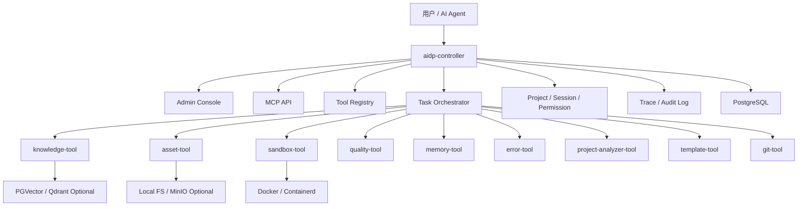
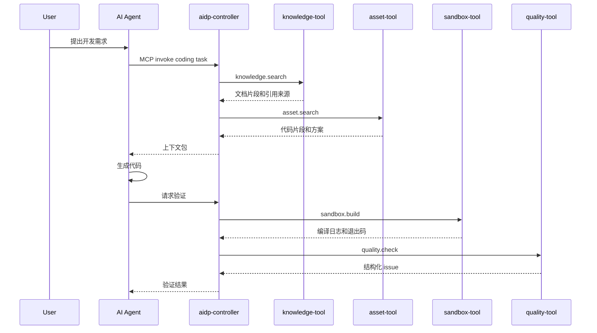
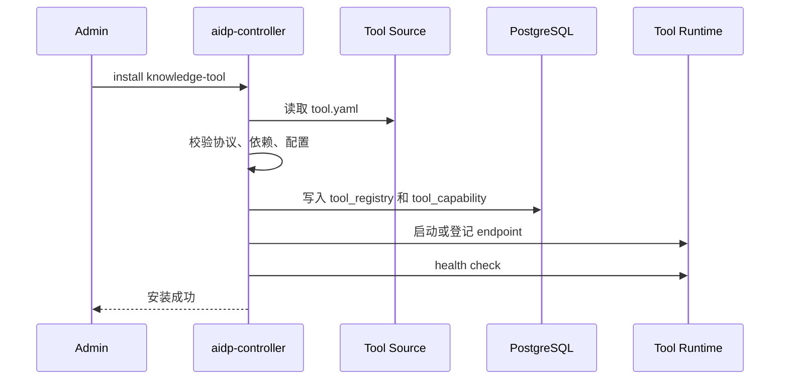

# AI 编程基础设施平台总体架构

## 1. 架构定位

本平台采用“主服务 + N 个可选安装工具”的架构：

```text
aidp-controller + optional tools
```

`aidp-controller` 是主服务，负责控制台、MCP、项目、会话、权限、审计、工具安装和工具编排。工具是可选能力包，例如 `knowledge-tool`、`asset-tool`、`sandbox-tool`、`quality-tool`、`memory-tool`。用户可以只安装一个工具，也可以安装完整工具链。

这套架构不是默认微服务，也不是极简单体，而是适合个人、团队和开源生态的可组合工具架构。

## 2. 架构原则

1. Controller 负责编排，不吞并所有工具业务。
2. 工具可选安装，用户不需要全量部署。
3. 工具必须可独立运行，不能强依赖 controller。
4. 工具通过 `tool.yaml` 声明能力、依赖、配置和接口。
5. MCP Skill 来自工具 capability，不写死在 controller 中。
6. 沙箱执行类工具必须独立隔离。
7. 默认不依赖 Nacos、Kubernetes、Redis、MinIO。
8. 企业部署可以按需引入注册中心、对象存储、队列和集群调度。

## 3. 总体拓扑



## 4. Controller 职责

`aidp-controller` 负责：

- 用户、工作区、项目管理。
- 会话和上下文管理。
- MCP API 暴露。
- 工具安装、卸载、启用、停用。
- 工具配置管理。
- 工具健康检查。
- Tool capability 到 MCP Skill 的映射。
- 任务编排和多工具调用。
- 权限校验。
- 调用链追踪。
- 审计日志。
- 管理后台托管。

`aidp-controller` 不负责：

- 不直接解析所有文档格式。
- 不直接执行不可信代码。
- 不直接实现所有语言的编译环境。
- 不直接绑定某个工具内部实现。

## 5. 工具职责

每个工具是独立能力单元。

工具必须具备：

- 独立 README。
- 独立配置文件。
- 独立 HTTP API。
- 独立 OpenAPI 文档。
- 独立健康检查。
- `tool.yaml` 工具清单。
- 可选 Docker 镜像。
- 可选 CLI。

工具运行模式：

| 模式 | 说明 |
|---|---|
| standalone | 工具独立运行，不需要 controller |
| managed | controller 安装、配置、调用工具 |
| remote | 工具部署在远端，controller 只登记 endpoint |

## 6. 核心工具

### 6.1 knowledge-tool

职责：

- 文档上传、解析、切片、向量化。
- 混合检索。
- 引用来源返回。

典型能力：

- `document.upload`
- `document.index`
- `knowledge.search`

### 6.2 asset-tool

职责：

- 代码片段管理。
- 项目模板管理。
- 历史方案管理。
- 代码资产检索。

典型能力：

- `asset.snippet.create`
- `asset.template.render`
- `asset.search`

### 6.3 sandbox-tool

职责：

- 脚本执行。
- 项目编译。
- 临时数据库验证。
- 执行日志采集。
- 资源限制和网络隔离。

典型能力：

- `sandbox.run`
- `sandbox.build.node`
- `sandbox.test.python`
- `sandbox.sql.validate`

### 6.4 quality-tool

职责：

- 编译日志解析。
- Lint 结果解析。
- 测试结果解析。
- 规则集校验。
- 结构化 issue 返回。

典型能力：

- `quality.check`
- `quality.parse_build_log`
- `quality.ruleset.validate`

### 6.5 memory-tool

职责：

- 项目长期记忆。
- 会话摘要。
- 上下文包生成。

典型能力：

- `memory.get_context`
- `memory.save_summary`
- `memory.upsert_project_memory`

### 6.6 扩展工具

| 工具 | 作用 |
|---|---|
| error-tool | 报错知识库、相似错误检索 |
| project-analyzer-tool | 项目结构扫描、依赖分析 |
| template-tool | 脚手架、模块模板、变量渲染 |
| git-tool | Git/Gitea 同步、提交分析 |
| eval-tool | Prompt、Skill、工具效果评测 |

## 7. 工具协议

所有工具必须暴露统一基础接口：

```text
GET  /health
GET  /tool/manifest
GET  /tool/capabilities
POST /tool/invoke
```

controller 只依赖这些标准接口，不依赖工具内部代码。

## 8. tool.yaml

每个工具必须提供 `tool.yaml`。

最小示例：

```yaml
apiVersion: aidp.dev/v1
kind: Tool

metadata:
  name: knowledge-tool
  version: 0.1.0
  description: Document ingestion and retrieval tool.

runtime:
  modes: [standalone, managed, remote]
  docker:
    image: aidp/knowledge-tool:0.1.0
    port: 8080

dependencies:
  required:
    - postgresql
  optional:
    - pgvector
    - minio

capabilities:
  - name: knowledge.search
    endpoint: POST /api/knowledge/search
    timeoutMs: 3000
    permission: knowledge:search
```

## 9. 典型调用链

### 9.1 AI 编程任务



### 9.2 工具安装



## 10. 部署形态

### 10.1 最小安装

```text
aidp-controller
postgres
```

用途：

- 工具管理。
- 项目管理。
- MCP 基础入口。

### 10.2 知识库安装

```text
aidp-controller
postgres + pgvector
knowledge-tool
```

用途：

- 文档知识库。
- RAG 检索。

### 10.3 编程闭环安装

```text
aidp-controller
postgres + pgvector
knowledge-tool
asset-tool
sandbox-tool
quality-tool
memory-tool
```

用途：

- 检索文档。
- 检索代码资产。
- 执行/编译代码。
- 质量校验。
- 上下文记忆。

### 10.4 完整安装

```text
aidp-controller
postgres + pgvector
minio
knowledge-tool
asset-tool
sandbox-tool
quality-tool
memory-tool
error-tool
project-analyzer-tool
template-tool
git-tool
eval-tool
```

## 11. 开源仓库建议

MVP 推荐 monorepo：

```text
ai-dev-platform/
  controller/
  tools/
    knowledge-tool/
    asset-tool/
    sandbox-tool/
    quality-tool/
    memory-tool/
    error-tool/
    project-analyzer-tool/
  sdk/
    tool-sdk-java/
    tool-sdk-python/
    tool-sdk-typescript/
  deploy/
    compose/
      core.yml
      knowledge.yml
      coding.yml
      full.yml
  docs/
```

后期工具成熟后可以拆成多仓库。

## 12. 企业级扩展

MVP 不默认引入：

- Nacos
- Kubernetes
- Redis
- RabbitMQ
- Qdrant
- MinIO

但保留扩展点：

- Tool registry 可从 PostgreSQL 迁移到注册中心。
- File storage 可从本地迁移到 MinIO/S3。
- Job table 可迁移到 Redis Stream/RabbitMQ。
- PGVector 可替换为 Qdrant。
- Docker Compose 可替换为 Kubernetes。

## 13. 结论

最终架构是：

```text
主服务统一控制，可选工具按需安装，工具能力标准化暴露。
```
