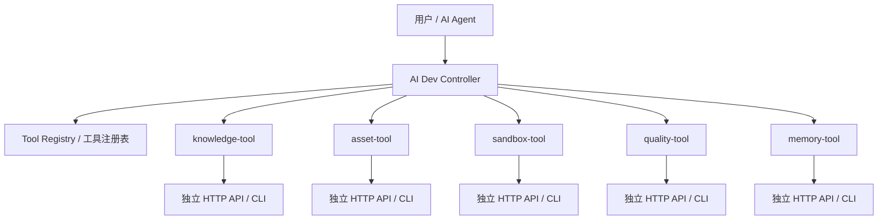

# 开源模块化设计说明

## 1. 设计结论

本系统建议设计成：

```text
AI Dev Controller + N 个可独立运行的工具
```

控制器不是所有功能的宿主，而是一个可选中枢。每个工具都应该能脱离控制器独立使用；当用户需要完整 AI 编程闭环时，再由控制器统一编排这些工具。

这种设计更适合开源：

- 用户可以只使用其中一个工具。
- 小团队可以用 Docker Compose 全量部署。
- 公司可以把工具接入自己的平台。
- 社区可以单独贡献某个工具，而不必理解整套系统。
- 后续可以发展插件生态。

## 2. 核心形态



## 3. 三种使用模式

### 3.1 Standalone 模式

用户只运行某一个工具。

例子：

```text
只部署 knowledge-tool
用于本地文档上传、向量化、检索
```

要求：

- 工具有自己的配置文件。
- 工具有自己的 REST API。
- 工具有自己的 CLI。
- 工具有自己的 Docker 镜像。
- 工具不依赖 Controller 才能启动。

### 3.2 Controlled 模式

用户部署 Controller 和多个工具。

例子：

```text
controller + knowledge-tool + asset-tool + sandbox-tool + quality-tool
```

要求：

- Controller 通过工具清单发现工具能力。
- Controller 统一处理用户、项目、会话、权限、审计。
- 工具只暴露能力，不关心复杂编排。

### 3.3 Embedded 模式

公司或开发者把某个工具集成到已有系统。

例子：

```text
已有研发平台只接入 sandbox-tool
已有文档平台只接入 knowledge-tool 的检索 API
```

要求：

- 工具 API 文档完整。
- 工具鉴权方式可配置。
- 工具数据模型清晰。

## 4. 控制器职责

Controller 负责：

- 工具注册与发现。
- MCP Skill 暴露。
- 任务编排。
- 会话上下文组装。
- 权限检查。
- 调用链 trace。
- 审计日志。
- 多工具结果聚合。
- 失败重试和错误标准化。

Controller 不负责：

- 不直接解析文档。
- 不直接存储代码片段。
- 不直接执行容器。
- 不直接跑 Lint。
- 不把所有工具代码内置到自己进程里。

## 5. 工具职责

每个工具负责一个明确能力域：

| 工具 | 独立能力 |
|---|---|
| knowledge-tool | 文档上传、解析、切片、向量化、检索 |
| asset-tool | 代码片段、模板、方案管理和检索 |
| sandbox-tool | 脚本执行、项目编译、临时环境 |
| quality-tool | Lint、测试、编译错误解析、质量规则 |
| memory-tool | 项目记忆、会话摘要、上下文包 |
| error-tool | 报错归档、相似错误检索 |
| project-analyzer-tool | 项目结构扫描、依赖分析、概要生成 |

## 6. 工具标准接口

每个工具至少提供以下接口：

```text
GET  /health
GET  /tool/manifest
GET  /tool/capabilities
POST /tool/invoke
```

### 6.1 health

响应：

```json
{
  "status": "UP",
  "tool": "knowledge-tool",
  "version": "0.1.0"
}
```

### 6.2 manifest

响应：

```json
{
  "name": "knowledge-tool",
  "version": "0.1.0",
  "description": "Document ingestion and retrieval tool",
  "modes": ["standalone", "controlled"],
  "base_url": "http://knowledge-tool:8080",
  "capabilities": [
    "document.upload",
    "document.index",
    "knowledge.search"
  ]
}
```

### 6.3 capabilities

响应：

```json
{
  "capabilities": [
    {
      "name": "knowledge.search",
      "description": "Search indexed documents",
      "input_schema": {
        "type": "object",
        "required": ["query"],
        "properties": {
          "query": { "type": "string" },
          "top_k": { "type": "integer", "default": 8 }
        }
      },
      "output_schema": {
        "type": "object",
        "properties": {
          "items": { "type": "array" }
        }
      }
    }
  ]
}
```

### 6.4 invoke

请求：

```json
{
  "trace_id": "uuid",
  "capability": "knowledge.search",
  "context": {
    "tenant_id": "uuid",
    "workspace_id": "uuid",
    "project_id": "uuid",
    "session_id": "uuid"
  },
  "input": {
    "query": "订单审批接口规范",
    "top_k": 8
  }
}
```

响应：

```json
{
  "trace_id": "uuid",
  "tool": "knowledge-tool",
  "capability": "knowledge.search",
  "success": true,
  "output": {},
  "source_refs": [],
  "elapsed_ms": 120
}
```

## 7. tool.yaml 标准

每个工具仓库根目录必须有 `tool.yaml`：

```yaml
name: knowledge-tool
version: 0.1.0
description: Document ingestion and retrieval tool
license: Apache-2.0

runtime:
  type: docker
  image: aidp/knowledge-tool:0.1.0
  ports:
    - 8080

modes:
  - standalone
  - controlled

dependencies:
  required:
    - postgresql
    - minio
  optional:
    - pgvector
    - qdrant

capabilities:
  - name: knowledge.search
    endpoint: POST /tool/invoke
    timeout_ms: 3000
    permission: knowledge:search
```

## 8. 服务发现建议

个人和小团队：

- 不使用 Nacos。
- 使用 Docker Compose 服务名访问。
- Controller 读取 `tools.local.yaml`。

示例：

```yaml
tools:
  - name: knowledge-tool
    base_url: http://knowledge-tool:8080
  - name: asset-tool
    base_url: http://asset-tool:8080
  - name: sandbox-tool
    base_url: http://sandbox-tool:8080
```

团队或公司：

- 可以把工具注册信息放 PostgreSQL。
- 管理后台支持新增、停用、测试工具连接。
- 多实例部署时再考虑 Nacos、Consul、Kubernetes Service。

## 9. 开源仓库组织

推荐 monorepo：

```text
ai-dev-platform/
  controller/
  tools/
    knowledge-tool/
    asset-tool/
    sandbox-tool/
    quality-tool/
    memory-tool/
  packages/
    tool-sdk-java/
    tool-sdk-python/
    common-schemas/
  deploy/
    compose/
      full.yml
      knowledge-only.yml
      sandbox-only.yml
  docs/
```

也可以后期拆分为多仓库：

```text
ai-dev-controller
aidp-knowledge-tool
aidp-asset-tool
aidp-sandbox-tool
aidp-quality-tool
aidp-memory-tool
```

MVP 推荐 monorepo，方便统一修改协议和示例。

## 10. Docker Compose Profiles

建议使用 profiles 支持按需启动：

```yaml
services:
  controller:
    profiles: ["full"]

  knowledge-tool:
    profiles: ["full", "knowledge"]

  asset-tool:
    profiles: ["full", "asset"]

  sandbox-tool:
    profiles: ["full", "sandbox"]
```

启动全量：

```bash
docker compose --profile full up -d
```

只启动知识库工具：

```bash
docker compose --profile knowledge up -d
```

## 11. 开源发布原则

- 每个工具都必须有独立 README。
- 每个工具都必须有最小可运行 demo。
- 每个工具都必须有 OpenAPI 文档。
- 每个工具都必须能独立构建 Docker 镜像。
- Controller 只能依赖工具协议，不能依赖工具内部代码。
- 公共 SDK 只放协议、客户端、错误模型，不放业务逻辑。

## 12. 推荐 MVP 改造

第一版开源 MVP 建议只包含：

1. controller
2. knowledge-tool
3. asset-tool
4. sandbox-tool
5. quality-tool
6. compose full profile
7. compose knowledge-only profile

memory-tool、error-tool、project-analyzer-tool 可以后续加入。

