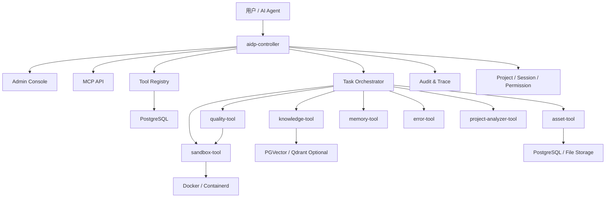

# 主服务 + N 个可选安装工具完整方案

## 1. 总体结论

推荐架构：

```text
aidp-controller + optional tools
```

也就是：

```text
一个主服务
  + N 个可选安装工具
  + 统一工具协议
  + 本地/团队/企业三种部署强度
```

主服务负责控制、编排、权限、项目、会话、审计、MCP 暴露和工具安装管理。工具负责具体能力，并且每个工具都可以独立运行，也可以被主服务统一接管。

这套方案比“单体主服务”更开放，比“默认分布式微服务”更轻。它适合个人、团队和开源生态。

## 2. 架构目标

必须满足：

1. 用户可以只安装一个工具，例如只安装文档知识库。
2. 用户可以全量安装，形成完整 AI 编程平台。
3. 工具可以独立运行，不强依赖主服务。
4. 主服务可以统一发现、安装、配置、调用工具。
5. 工具能力可以暴露为 MCP Skill。
6. 不强制依赖 Nacos、Kubernetes、Redis、MinIO。
7. 企业部署时允许升级为分布式形态。

## 3. 总体架构



## 4. 核心组成

### 4.1 aidp-controller

主服务职责：

- 用户、工作区、项目管理。
- 会话管理。
- MCP API 暴露。
- 工具安装、卸载、启停。
- 工具注册表。
- 工具配置管理。
- 工具健康检查。
- 任务编排。
- 权限控制。
- 调用链 trace。
- 审计日志。
- 管理后台。

主服务不做：

- 不直接解析 PDF。
- 不直接跑 Docker 沙箱。
- 不直接实现所有工具业务。
- 不把工具逻辑全部写死在 controller 中。

### 4.2 optional tools

每个工具是一个能力包，可以安装，也可以不安装。

工具必须提供：

- `tool.yaml`
- HTTP API
- OpenAPI 文档
- MCP capability 定义
- Docker 镜像或本地运行命令
- 健康检查
- 配置 schema
- 权限声明
- 可选数据库迁移脚本
- 可选管理后台扩展页面

### 4.3 PostgreSQL

Controller 默认依赖 PostgreSQL。

用途：

- 用户、项目、会话。
- 工具注册表。
- 工具配置。
- 审计日志。
- 任务记录。
- 部分工具的默认元数据。

### 4.4 文件存储

默认使用本地文件存储。

可选升级：

- MinIO
- S3
- NAS

工具不直接绑定具体对象存储，而是通过配置选择 storage provider。

## 5. 工具清单

### 5.1 第一优先级工具

| 工具 | 是否建议首批 | 作用 |
|---|---:|---|
| knowledge-tool | 是 | 文档上传、解析、切片、向量化、检索 |
| asset-tool | 是 | 代码片段、模板、历史方案管理 |
| sandbox-tool | 是 | 代码执行、项目编译、SQL 临时验证 |
| quality-tool | 是 | 编译结果解析、Lint、测试、规则校验 |
| memory-tool | 是 | 项目记忆、会话摘要、上下文包 |

### 5.2 第二优先级工具

| 工具 | 作用 |
|---|---|
| error-tool | 报错知识库、相似错误检索 |
| project-analyzer-tool | 扫描代码结构、依赖、接口、数据库 |
| template-tool | 项目脚手架、模板渲染、模块初始化 |
| git-tool | Gitea/Git 仓库同步、提交分析 |
| doc-import-tool | 网页、PDF、Word、Git Markdown 批量导入 |

### 5.3 第三优先级工具

| 工具 | 作用 |
|---|---|
| eval-tool | Prompt/Skill/工具效果评测 |
| api-capture-tool | 抓包导入、接口文档生成 |
| android-build-tool | Android/Flutter 专用构建环境 |
| sql-review-tool | SQL 风险扫描、索引建议 |

## 6. 工具运行模式

每个工具支持三种模式。

### 6.1 standalone 模式

工具独立运行。

例子：

```bash
docker run aidp/knowledge-tool:latest
```

或：

```bash
aidp-knowledge serve
```

适合：

- 用户只想用某一个工具。
- 第三方系统集成单个能力。
- 社区独立维护某个工具。

### 6.2 managed 模式

工具由 controller 管理。

特点：

- controller 安装工具。
- controller 写入配置。
- controller 执行健康检查。
- controller 将工具 capability 暴露为 MCP Skill。
- controller 统一记录审计。

适合：

- 个人或团队使用完整平台。
- AI Agent 需要统一调用多个工具。

### 6.3 remote 模式

工具部署在远端，controller 只登记 endpoint。

适合：

- 公司已有工具服务。
- 沙箱部署在隔离机器。
- 多团队共享同一个知识库服务。

## 7. 工具包结构

每个工具仓库建议结构：

```text
knowledge-tool/
  tool.yaml
  README.md
  Dockerfile
  openapi.yaml
  config.example.yaml
  migrations/
  src/
  ui/
  examples/
  tests/
```

如果采用 monorepo：

```text
ai-dev-platform/
  controller/
  tools/
    knowledge-tool/
    asset-tool/
    sandbox-tool/
    quality-tool/
    memory-tool/
  sdk/
    java/
    python/
    typescript/
  deploy/
  docs/
```

## 8. tool.yaml 标准

示例：

```yaml
apiVersion: aidp.dev/v1
kind: Tool

metadata:
  name: knowledge-tool
  displayName: Knowledge Tool
  version: 0.1.0
  description: Document ingestion, indexing and retrieval.
  license: Apache-2.0

runtime:
  modes:
    - standalone
    - managed
    - remote
  docker:
    image: aidp/knowledge-tool:0.1.0
    port: 8080
  local:
    command: aidp-knowledge serve

dependencies:
  required:
    - postgresql
  optional:
    - pgvector
    - qdrant
    - minio

storage:
  supports:
    - local
    - minio
    - s3

configSchema:
  type: object
  properties:
    vectorStore:
      type: string
      enum: [pgvector, qdrant]
      default: pgvector
    chunkSize:
      type: integer
      default: 800

capabilities:
  - name: knowledge.search
    description: Search indexed documents.
    endpoint: POST /api/knowledge/search
    timeoutMs: 3000
    permission: knowledge:search
    inputSchema:
      type: object
      required: [query]
      properties:
        query:
          type: string
        topK:
          type: integer
          default: 8
    outputSchema:
      type: object
      properties:
        items:
          type: array

health:
  endpoint: GET /health

ui:
  entry: /ui/knowledge
```

## 9. Controller 工具安装流程

### 9.1 安装来源

支持：

- 本地目录。
- Git 仓库。
- OCI 镜像。
- 官方工具市场索引文件。

MVP 推荐先支持本地目录和官方索引文件。

### 9.2 安装步骤

```text
读取 tool.yaml
  -> 校验版本和协议
  -> 检查依赖
  -> 写入 tool_registry
  -> 写入 tool_capability
  -> 写入默认配置
  -> 可选执行 migrations
  -> 启动容器或登记 remote endpoint
  -> 健康检查
  -> 暴露 MCP Skill
```

### 9.3 安装命令

```bash
aidpctl tool install knowledge-tool
aidpctl tool install ./tools/knowledge-tool
aidpctl tool install gh:owner/knowledge-tool
```

### 9.4 卸载命令

```bash
aidpctl tool uninstall knowledge-tool
```

卸载策略：

- 默认只停用工具，不删除数据。
- `--purge` 才删除工具数据。

## 10. Controller 数据模型

### 10.1 tool_registry

```sql
create table tool_registry (
  id uuid primary key,
  name varchar(128) not null unique,
  display_name varchar(128) not null,
  version varchar(64) not null,
  status varchar(32) not null,
  install_mode varchar(32) not null,
  base_url text,
  manifest jsonb not null,
  config jsonb not null default '{}',
  installed_at timestamptz not null,
  updated_at timestamptz not null
);
```

### 10.2 tool_capability

```sql
create table tool_capability (
  id uuid primary key,
  tool_id uuid not null,
  name varchar(128) not null,
  description text,
  endpoint text not null,
  permission varchar(128),
  input_schema jsonb not null,
  output_schema jsonb not null,
  timeout_ms int not null,
  enabled boolean not null default true,
  unique (tool_id, name)
);
```

### 10.3 tool_invocation

```sql
create table tool_invocation (
  id uuid primary key,
  trace_id uuid not null,
  session_id uuid,
  project_id uuid,
  tool_name varchar(128) not null,
  capability_name varchar(128) not null,
  status varchar(32) not null,
  input_summary jsonb,
  output_summary jsonb,
  error_message text,
  elapsed_ms int,
  created_at timestamptz not null
);
```

## 11. Controller API

### 11.1 工具安装

```text
POST /api/tools/install
```

请求：

```json
{
  "source": "official:knowledge-tool",
  "install_mode": "managed",
  "config": {
    "vectorStore": "pgvector"
  }
}
```

### 11.2 工具列表

```text
GET /api/tools
```

### 11.3 工具能力列表

```text
GET /api/tools/{toolName}/capabilities
```

### 11.4 工具调用

```text
POST /api/tools/invoke
```

请求：

```json
{
  "trace_id": "uuid",
  "project_id": "uuid",
  "session_id": "uuid",
  "capability": "knowledge.search",
  "input": {
    "query": "订单审批规则",
    "topK": 8
  }
}
```

### 11.5 MCP 调用

```text
POST /api/mcp/invoke
```

Controller 将 MCP Skill 映射到 tool capability。

## 12. 工具通信协议

工具统一暴露：

```text
GET  /health
GET  /tool/manifest
GET  /tool/capabilities
POST /tool/invoke
```

工具调用请求：

```json
{
  "trace_id": "uuid",
  "capability": "knowledge.search",
  "context": {
    "tenant_id": "uuid",
    "workspace_id": "uuid",
    "project_id": "uuid",
    "session_id": "uuid",
    "user_id": "uuid"
  },
  "input": {}
}
```

工具调用响应：

```json
{
  "trace_id": "uuid",
  "tool": "knowledge-tool",
  "capability": "knowledge.search",
  "success": true,
  "output": {},
  "source_refs": [],
  "elapsed_ms": 120
}
```

## 13. 工具依赖策略

工具声明依赖，由 controller 检查。

依赖类型：

- required：没有就不能安装。
- optional：没有也能安装，但部分能力不可用。
- external：用户自己提供，例如远程 Qdrant。

例子：

| 工具 | 必需依赖 | 可选依赖 |
|---|---|---|
| knowledge-tool | PostgreSQL | PGVector、Qdrant、MinIO |
| asset-tool | PostgreSQL | MinIO、Gitea |
| sandbox-tool | Docker/Containerd | Kubernetes Job |
| quality-tool | sandbox-tool | language-specific images |
| memory-tool | PostgreSQL | Redis |

## 14. 部署方案

### 14.1 最小安装

```text
controller
postgres
```

能力：

- 项目管理。
- 工具安装管理。
- MCP 基础入口。
- 还没有具体 AI 编程能力。

### 14.2 知识库安装

```text
controller
postgres + pgvector
knowledge-tool
```

能力：

- 文档入库。
- 文档检索。
- MCP knowledge.search。

### 14.3 编程闭环安装

```text
controller
postgres + pgvector
knowledge-tool
asset-tool
sandbox-tool
quality-tool
memory-tool
```

能力：

- 文档检索。
- 代码资产检索。
- 沙箱执行。
- 质量校验。
- 上下文记忆。
- AI 编程闭环。

### 14.4 完整安装

```text
controller
postgres + pgvector
minio
knowledge-tool
asset-tool
sandbox-tool
quality-tool
memory-tool
error-tool
project-analyzer-tool
template-tool
git-tool
eval-tool
```

## 15. Docker Compose Profiles

```yaml
services:
  controller:
    profiles: ["core", "knowledge", "coding", "full"]

  postgres:
    profiles: ["core", "knowledge", "coding", "full"]

  knowledge-tool:
    profiles: ["knowledge", "coding", "full"]

  asset-tool:
    profiles: ["coding", "full"]

  sandbox-tool:
    profiles: ["coding", "full"]

  quality-tool:
    profiles: ["coding", "full"]

  memory-tool:
    profiles: ["coding", "full"]

  minio:
    profiles: ["full"]
```

启动知识库：

```bash
docker compose --profile knowledge up -d
```

启动编程闭环：

```bash
docker compose --profile coding up -d
```

启动完整平台：

```bash
docker compose --profile full up -d
```

## 16. 开源仓库建议

MVP 推荐 monorepo：

```text
ai-dev-platform/
  controller/
  tools/
    knowledge-tool/
    asset-tool/
    sandbox-tool/
    quality-tool/
    memory-tool/
    error-tool/
    project-analyzer-tool/
  sdk/
    tool-sdk-java/
    tool-sdk-python/
    tool-sdk-typescript/
  deploy/
    compose/
      core.yml
      knowledge.yml
      coding.yml
      full.yml
  docs/
```

后期可拆多仓库：

```text
aidp-controller
aidp-knowledge-tool
aidp-asset-tool
aidp-sandbox-tool
aidp-quality-tool
aidp-memory-tool
```

## 17. 开发优先级

第一阶段：

1. controller 基础工程。
2. tool_registry 数据模型。
3. tool.yaml 解析。
4. 本地工具安装。
5. capability 注册。
6. MCP Skill 映射。
7. knowledge-tool。

第二阶段：

1. asset-tool。
2. sandbox-tool。
3. quality-tool。
4. memory-tool。
5. coding compose profile。

第三阶段：

1. error-tool。
2. project-analyzer-tool。
3. template-tool。
4. 工具市场索引。
5. 工具 UI 扩展。

## 18. 设计边界

不要做：

- 不默认引入 Nacos。
- 不默认 Kubernetes。
- 不要求每个工具必须部署成远程服务。
- 不把工具代码写死在 controller。
- 不要求用户全量安装。
- 不在 MVP 做复杂插件市场。

必须做：

- 工具协议稳定。
- 工具可选安装。
- 工具可独立运行。
- Controller 能统一接管工具。
- 所有工具调用有 trace 和审计。
- MCP Skill 来自工具 capability。

## 19. 一句话方案

这套系统应该是：

```text
一个 AI 编程控制台，按需安装工具包，装得越多能力越完整。
```

它不是极简单体，也不是默认分布式平台，而是适合开源生态的“主服务 + 可选工具”架构。

