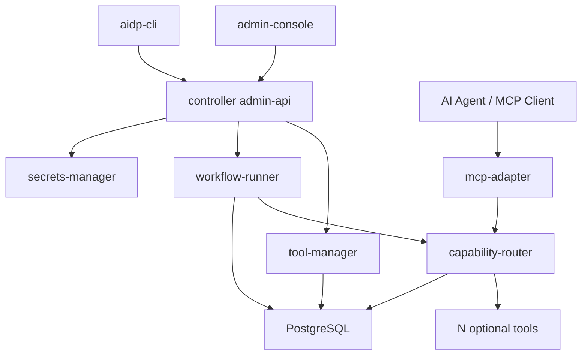

# aidp-controller 架构设计

## 1. 总体架构



controller 是一个 Python 单体服务，内部模块化，不拆微服务。

## 2. 推荐技术栈

| 能力 | 技术 |
|---|---|
| Runtime | Python 3.13 |
| Language | Python |
| HTTP | FastAPI |
| Schema | Pydantic |
| DB | PostgreSQL + pgvector |
| Cache | Redis |
| ORM | SQLAlchemy 2.0 (async) |
| Migration | SQL migration |
| Log | structlog |
| Test | pytest |
| OpenAPI | FastAPI 内置 |
| MCP | FastMCP |

## 3. 部署形态

### 3.1 个人模式

```text
controller
postgres
optional tools
local storage
```

不需要 Redis、MinIO、Nacos、Kubernetes。

### 3.2 团队模式

```text
controller
postgres
minio optional
redis optional
optional tools
admin-console
```

### 3.3 企业扩展

只有在确实需要多实例时，才引入 Kubernetes、Nacos/Consul、外部密钥系统。

## 4. 调用链路

### 4.1 工具安装

```text
upload/register tool source
  -> read tool.yaml
  -> validate manifest schema
  -> health check
  -> fetch capabilities
  -> save tool registry
  -> expose MCP skills
```

### 4.2 Capability 调用

```text
receive invoke request
  -> resolve workspace/project/session
  -> permission check
  -> input schema validation
  -> approval check
  -> call tool /tool/invoke
  -> normalize response
  -> audit log
```

### 4.3 Workflow 执行

```text
create workflow run
  -> enqueue steps in PostgreSQL
  -> execute step
  -> persist step output
  -> continue/branch/retry
  -> wait approval if needed
  -> produce final summary
```

## 5. 关键设计原则

- controller 只编排，不吞并工具业务。
- 工具发现靠 `tool.yaml + /tool/capabilities + health check`，不依赖注册中心。
- 工作流 MVP 使用数据库 job 表，不引入复杂消息队列。
- 所有外部调用都必须有 trace_id。
- 所有跨项目数据访问必须被 ScopeGuard 拦截。
