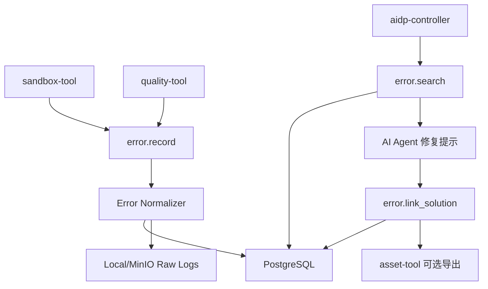

# error-tool 架构设计

## 1. 架构定位

`error-tool` 位于执行和质量校验之后，是失败反馈闭环的一部分。



## 2. 运行模式

| 模式 | 说明 |
|---|---|
| standalone | 本地 HTTP 服务 + PostgreSQL/SQLite 可选，用于个人排坑库 |
| managed | controller 安装并统一调用，使用平台 PostgreSQL 和对象存储 |
| remote | 团队部署统一 error-tool，多个 controller 远程调用 |

MVP 推荐 PostgreSQL。个人轻量版可支持 SQLite，但文档和 API 以 PostgreSQL 为准。

## 3. 核心流程

### 3.1 记录错误

```text
receive raw log
  -> redact secrets
  -> detect error type
  -> normalize fields
  -> compute fingerprint
  -> save raw log
  -> upsert error_case
  -> optional embedding
  -> return case id
```

### 3.2 检索相似错误

```text
normalize query/current error
  -> exact fingerprint match
  -> structured field match
  -> keyword or vector search
  -> rank by similarity/status/recency/project scope
  -> return candidate solutions
```

### 3.3 解决方案闭环

```text
link root cause and fix steps
  -> update status analyzed/resolved
  -> record verification source
  -> update solution quality score
  -> optional export to asset-tool
```

## 4. 外部依赖

| 依赖 | 必选 | 用途 |
|---|---|---|
| PostgreSQL | 是 | error_case、solution、索引 |
| 本地文件/MinIO | 是 | 大日志和附件 |
| pgvector/Qdrant | 否 | 相似错误向量检索 |
| asset-tool | 否 | 导出高价值解决方案 |
| sandbox-tool | 否 | 自动记录编译失败 |
| quality-tool | 否 | 自动记录质量检查失败 |

## 5. 数据隔离

- 写入时必须从 tool context 获取 `workspace_id/project_id/session_id`。
- 检索默认只查当前 project。
- `include_workspace=true` 时可查同 workspace 下共享错误案例，但必须排除标记为 `project_private=true` 的记录。
- 不允许跨 workspace 检索。

## 6. 降级策略

- 向量检索不可用：使用 fingerprint + 关键词检索。
- 对象存储不可用：小日志直接写数据库，大日志返回 `DEPENDENCY_UNAVAILABLE`。
- 无法识别 error_type：存为 `unknown`，仍保留 raw log 和 query 检索能力。

## 7. 安全策略

- `SecretRedactor` 在保存前脱敏。
- raw log 默认不返回全文，只返回摘要和 object key。
- 对外响应不得包含环境变量完整值。
- 导出到 asset-tool 前必须去除项目敏感路径和凭据。
