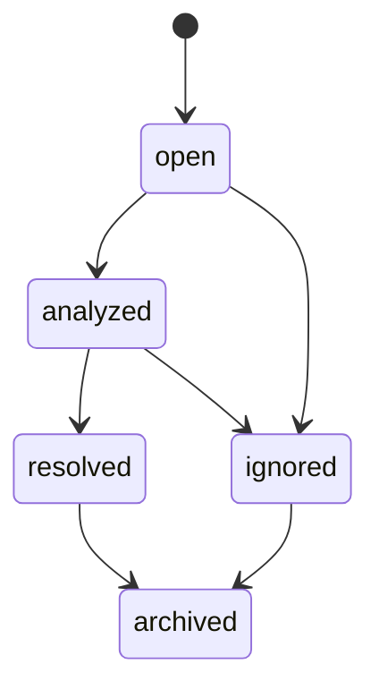

# error-tool 模块设计

## 1. 模块划分

| 模块 | 职责 |
|---|---|
| `ErrorInvokeController` | `/tool/invoke` capability 路由 |
| `ErrorCaseController` | 独立 REST API |
| `ErrorRecordService` | 错误记录、脱敏、归一化、入库 |
| `ErrorSearchService` | 相似错误检索与排序 |
| `SolutionService` | 根因和修复方案管理 |
| `ErrorNormalizerRegistry` | 管理不同错误类型 normalizer |
| `FingerprintService` | 生成稳定错误指纹 |
| `SecretRedactor` | 日志脱敏 |
| `RawLogStorage` | 原始日志存储抽象 |
| `AssetExportService` | 导出解决方案到 asset-tool |

## 2. ErrorNormalizer 设计

接口：

```text
supports(raw_log, metadata) -> boolean
normalize(raw_log, metadata) -> NormalizedError
```

MVP normalizer：

- `TypeScriptCompileNormalizer`
- `PythonExceptionNormalizer`
- `NodeRuntimeNormalizer`
- `TestFailureNormalizer`
- `DependencyConflictNormalizer`
- `FallbackNormalizer`

`NormalizedError` 字段：

- `error_type`
- `main_message`
- `root_exception`
- `file_path`
- `line_number`
- `symbol`
- `module_name`
- `task_name`
- `dependency`
- `test_name`
- `fingerprint_parts`
- `tags`

## 3. Fingerprint 规则

fingerprint 用于识别“本质相同”的错误。

推荐组成：

```text
error_type + root_exception + normalized_main_message + symbol + dependency + project_relative_file
```

归一化时必须移除：

- 绝对路径前缀。
- 行号可选参与，默认权重低。
- 临时目录。
- 时间戳。
- UUID。
- 随机端口。

## 4. 相似度排序

排序分数：

```text
score = fingerprint_match * 0.35
      + text_similarity * 0.25
      + structured_match * 0.20
      + project_scope_score * 0.10
      + solution_quality * 0.10
```

`project_scope_score`：

- 当前 project：1.0
- 同 workspace 共享：0.7
- global 公共案例：0.5

`solution_quality` 根据 resolved 次数、最近验证时间、用户评分计算。

## 5. 错误生命周期



规则：

- `error.record` 默认创建 `open`。
- `error.link_solution` 后状态可变为 `analyzed`。
- `error.resolve` 后状态为 `resolved`。
- `ignored/archived` 默认不参与 search，除非显式指定。

## 6. 解决方案质量

解决方案质量字段：

- `verified_count`
- `failed_count`
- `last_verified_at`
- `rating`
- `verified_by_tool`

当 sandbox/quality 使用某方案修复成功后，controller 可回调增加 `verified_count`。

## 7. 异常处理

| 场景 | 错误码 |
|---|---|
| raw_log 为空 | `VALIDATION_ERROR` |
| raw_log 超出限制 | `VALIDATION_ERROR` |
| 无权读取案例 | `FORBIDDEN` |
| case 不存在 | `NOT_FOUND` |
| 对象存储不可用 | `DEPENDENCY_UNAVAILABLE` |
| normalizer 异常 | 降级 fallback，不直接失败 |

## 8. 扩展点

- 新增语言 normalizer：TypeScript、Python、Node.js、Flutter。
- 接入本地 embedding 模型。
- 接入 Git diff，自动抽取修复 patch。
- 自动从 CI webhook 记录失败。
