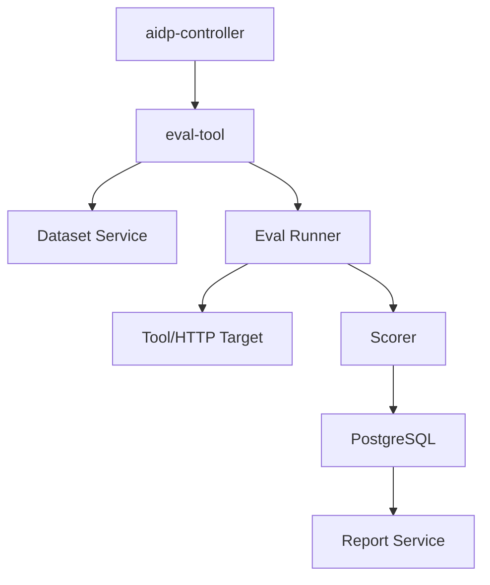

# eval-tool 架构设计

## 1. 架构



## 2. 运行流程

```text
load dataset
  -> select cases
  -> call target
  -> capture response/tool calls
  -> run scorers
  -> save results
  -> generate report
```

## 3. Target 类型

- `tool_invoke`：调用 `/tool/invoke`。
- `http`：调用普通 HTTP API。
- `manual`：只生成待人工执行任务。

## 4. Scorer 类型

- JSON schema 校验。
- 正则匹配。
- 字段相等。
- 包含/不包含文本。
- latency 阈值。
- 人工评分占位。

## 5. 隔离

评测数据按 workspace/project 隔离。eval run 必须记录目标版本、工具版本、配置摘要。
