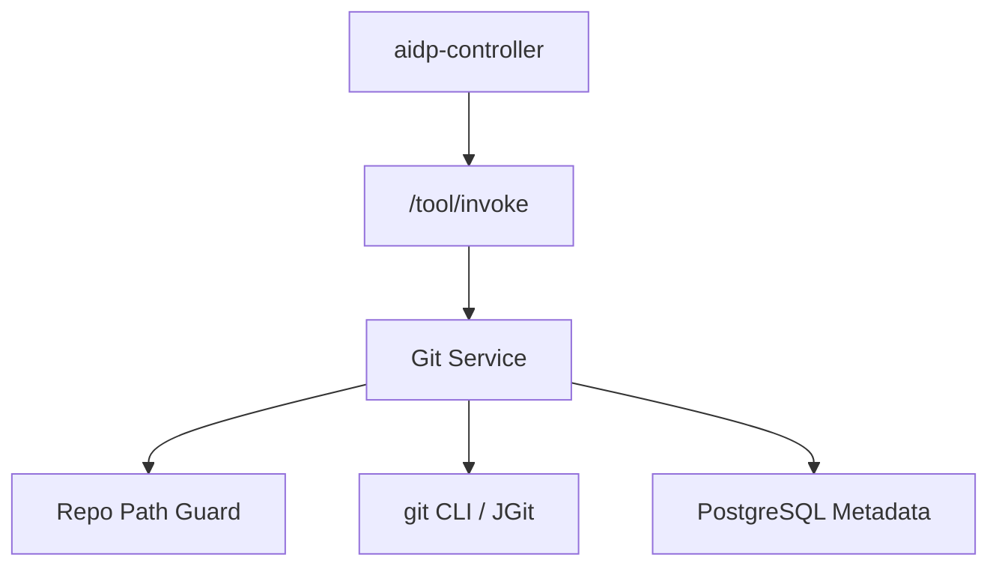

# git-tool 架构设计

## 1. 架构

## 2. 仓库访问策略

MVP 推荐调用 Git CLI，但所有命令必须由服务端白名单构造，不允许调用方传入原始命令。

允许命令能力：

- `git status --porcelain`
- `git rev-parse`
- `git diff`
- `git log`
- `git show`
- `git add` 和 `git commit`，仅在写操作启用时。

## 3. 核心流程

### repo_status

校验 repo -> 读取 branch/head -> 读取 porcelain status -> 分类 staged/unstaged/untracked。

### diff_summary

读取 diff -> 按文件拆分 -> 统计 additions/deletions -> 截断大文件 -> 生成摘要字段。

### create_commit

确认写操作启用 -> 校验文件路径 -> git add 指定文件 -> git commit -m 固定 message -> 返回 commit hash。

## 4. 安全边界

- 禁止 shell 拼接用户输入。
- 使用参数数组执行进程。
- command timeout 默认 30 秒。
- 最大 diff bytes 可配置。
