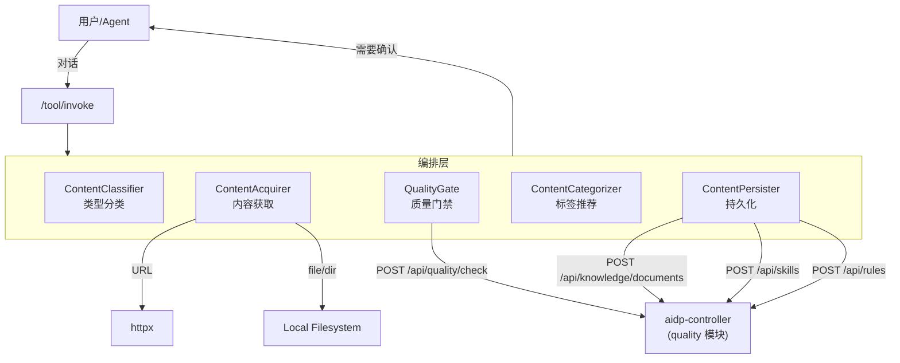
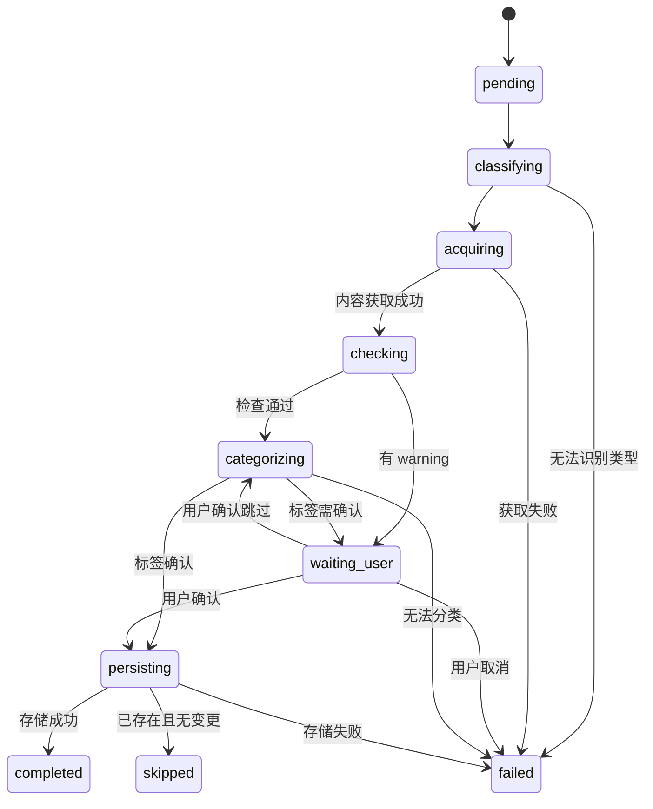

# importer-tool 架构设计

## 1. 架构



## 2. 核心流程

### 2.1 单次导入流程

```text
User: "帮我把这份架构文档导入知识库"
  -> classify(content)
     -> type=knowledge, domain=architecture
     -> 问用户: "识别为『知识』类型，标签建议: architecture/topology，确认？"
  -> acquire(source)
     -> 根据来源类型获取内容
     -> 返回 content + metadata
  -> quality_check(content, type)
     -> 调用 POST /api/quality/check
     -> 有问题 → 展示给用户，问是否修复/跳过
  -> categorize(content, type)
     -> 推荐 tags/category/severity/scope
     -> 问用户确认
  -> persist(type, content, metadata)
     -> 调用对应模块 API
     -> 返回 result + 访问链接
  -> 回答用户: "已导入，文档 ID: xxx"
```

### 2.2 批量导入流程

```text
User: "把 docs/ 目录下所有文档导入"
  -> acquire(directory)
     -> 扫描目录，返回文件列表（含路径/大小/扩展名）
     -> 问用户: "发现 42 个文件，是否全部导入？"
  -> for each file:
       classify(content)
       categorize(content)
       quality_check(content)
  -> 汇总后展示导入清单（含建议类型/标签/检查结果）
     -> 问用户: "42 个文件中 38 个无问题、4 个有 warning，是否全部确认？"
  -> for each confirmed:
       persist(type, content, metadata)
  -> 回答用户: "已导入 42/42，其中 4 个有 warning 已跳过"
```

## 3. 编排状态机



## 4. 依赖

| 依赖 | 必选 | 用途 |
|------|------|------|
| aidp-controller | 是 | 调用 quality-check、knowledge、skills、rules API |
| 本地文件系统 | 是 | 读取文件和目录 |
| httpx | 是 | URL 内容抓取 |
| quality-tool | 否 | 增强质量检查（如有独立部署） |

## 5. 安全边界

- URL 抓取限制协议为 http/https，禁止 file://、内部 IP 段。
- 目录扫描限制在用户指定路径内，拒绝符号链接穿越。
- 导入内容经过 quality check 安全扫描后才写入。
- secret 变量不得记录日志。
