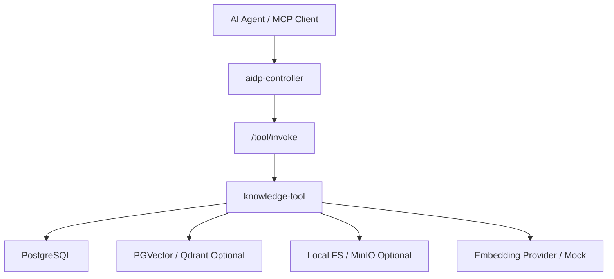
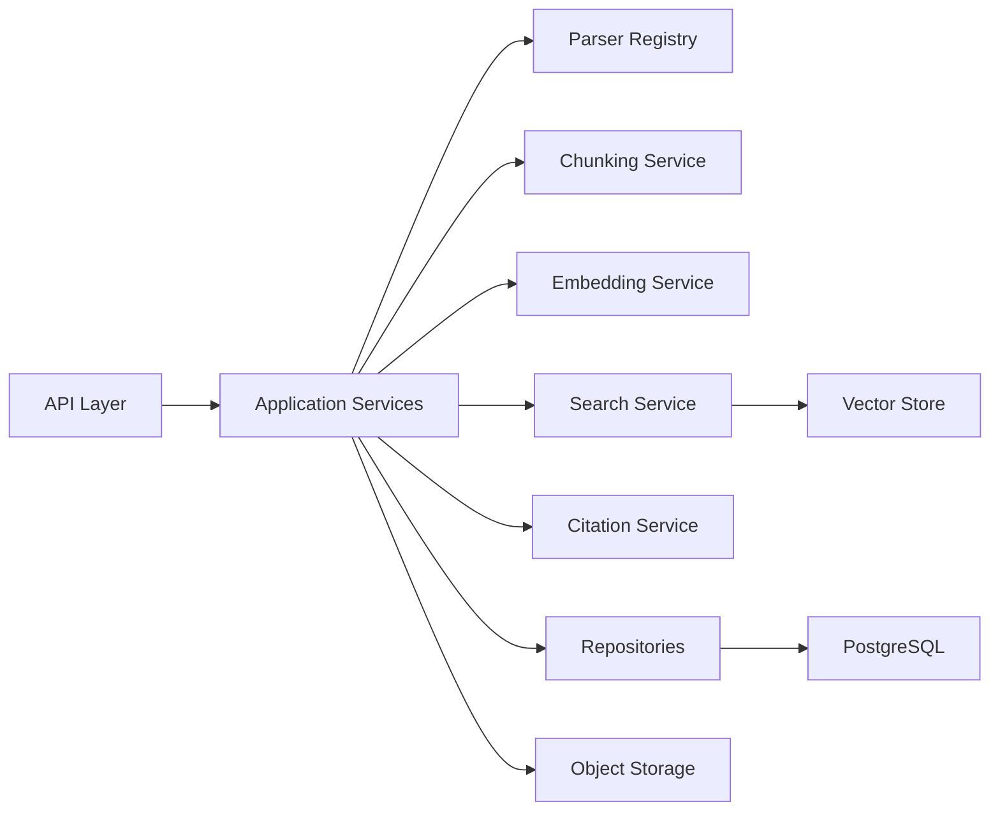
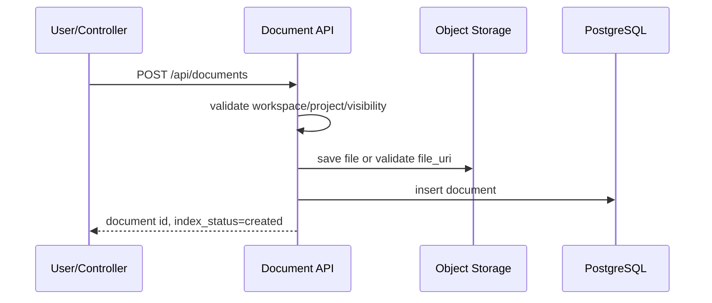
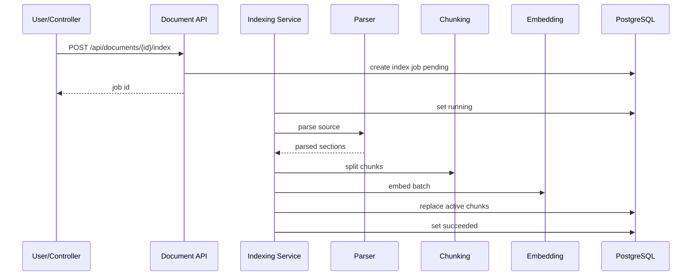
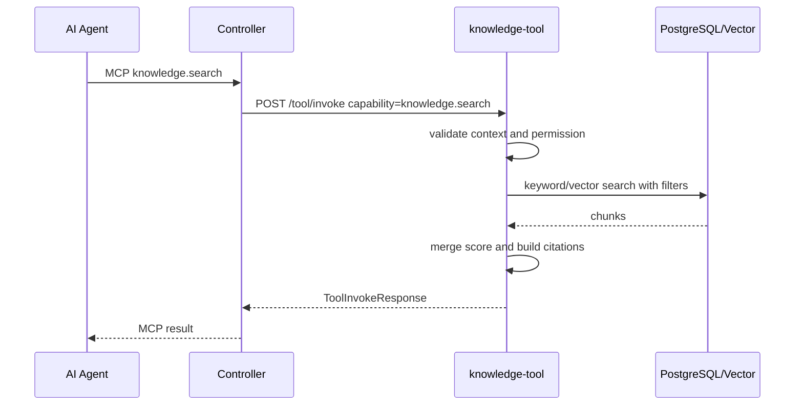

# knowledge-tool 架构设计

## 1. 架构定位

`knowledge-tool` 是一个独立工具服务，不是 `aidp-controller` 的内部模块。它通过统一工具协议与 controller 集成，也可以脱离 controller 单独运行。

在平台中的位置：



## 2. 运行模式

### 2.1 standalone

用户直接启动工具：

```bash
aidp-knowledge serve --config config.yaml
```

或：

```bash
docker run -p 18081:8080 aidp/knowledge-tool:0.1.0
```

standalone 模式必须提供完整业务 API 和工具协议 API。权限可以使用本地 token 或开发模式配置。

### 2.2 managed

controller 安装工具后管理其生命周期：

```text
controller 读取 tool.yaml
  -> 写入工具注册表
  -> 写入配置
  -> 启动工具
  -> 健康检查
  -> 注册 capability
  -> 暴露 MCP Skill
```

managed 模式下，controller 在调用前做权限校验，工具内部仍需二次校验数据范围。

### 2.3 remote

工具部署在独立机器或团队共享服务上，controller 只登记 endpoint。

remote 模式必须要求：

- HTTPS 或内网可信网络。
- API token。
- 版本兼容检查。
- 健康检查。

## 3. 内部组件



### 3.1 API Layer

职责：

- 暴露工具协议接口。
- 暴露文档管理接口。
- 暴露检索接口。
- 请求参数校验。
- trace_id 提取和返回。
- 错误模型转换。

### 3.2 Application Services

职责：

- 编排文档创建、上传、索引、删除。
- 编排检索流程。
- 管理索引任务状态。
- 做权限和范围校验。

### 3.3 Parser Registry

职责：

- 根据 MIME 类型、文件扩展名、显式 parser 参数选择解析器。
- 输出统一 `ParsedDocument`。
- 隔离 PDF/Word 等重依赖解析器，避免 MVP 被复杂依赖拖慢。

### 3.4 Chunking Service

职责：

- 把 `ParsedDocument` 切为稳定 chunk。
- 保留标题路径、行号、页码和 hash。
- 控制 chunk size 和 overlap。

### 3.5 Embedding Service

职责：

- 将 chunk content 转成向量。
- 支持 mock provider。
- 支持批处理。
- 记录 provider、model、dimension。

### 3.6 Search Service

职责：

- 执行 keyword、vector、hybrid 检索。
- 合并分数。
- 做权限过滤。
- 生成 source refs。

### 3.7 Storage

对象存储用于保存原始文件。MVP 默认本地文件系统：

```text
data/
  knowledge/
    files/{workspace_id}/{document_id}/{version}/{filename}
```

后续可替换为 MinIO/S3。

## 4. 关键流程

### 4.1 文档上传和登记



### 4.2 文档索引



### 4.3 检索



## 5. 部署架构

### 5.1 最小部署

```text
knowledge-tool
postgres
```

适合个人本地使用。向量能力可使用 PGVector 或 mock vector store。

### 5.2 controller 托管部署

```text
aidp-controller
postgres
knowledge-tool
```

controller 和 tool 可以共享 PostgreSQL，也可以使用不同 schema。

### 5.3 完整部署

```text
aidp-controller
postgres + pgvector
knowledge-tool
minio
qdrant optional
embedding provider
```

## 6. 数据一致性设计

### 6.1 文档和 chunk 版本

文档更新后不能直接覆盖旧 chunk。推荐策略：

1. 创建新的 `document_version`。
2. 新版本索引成功后标记为 active。
3. 旧版本保留一段时间用于回滚。

MVP 可简化为：

- `document.version` 保存当前版本。
- 重建索引时先删除旧 chunk 再写入新 chunk。
- 生产增强再引入 `document_version` 表。

### 6.2 索引任务幂等

同一文档同一 checksum 重复索引时：

- 如果已有成功索引，直接返回已有结果。
- 如果正在索引，返回当前 job。
- 如果上次失败，允许重新创建 job。

### 6.3 软删除

删除文档时：

- `document.deleted_at` 写入时间。
- chunk 查询默认过滤。
- 后台清理任务物理删除文件和 chunk。

## 7. 扩展点

| 扩展点 | 接口 | MVP 实现 | 后续实现 |
|---|---|---|---|
| Parser | `DocumentParser` | Markdown/TXT/Source | PDF/Word/HTML/OpenAPI |
| Chunker | `ChunkingStrategy` | heading/paragraph/line | AST/semantic chunk |
| Embedding | `EmbeddingProvider` | mock | OpenAI-compatible/local model |
| Vector Store | `VectorStore` | PGVector/mock | Qdrant/Milvus |
| Rerank | `RerankProvider` | none | cross-encoder/local rerank |
| Storage | `ObjectStorage` | local | MinIO/S3 |

## 8. 失败隔离

- Parser 失败只影响当前索引任务。
- Embedding provider 不可用时返回 `DEPENDENCY_UNAVAILABLE`。
- Vector store 不可用时 keyword search 可以降级，但响应必须标记 `degraded=true`。
- 单个文档索引失败不能阻塞其它文档。

## 9. 与 controller 的边界

controller 负责：

- 工具安装。
- 权限预检。
- capability 注册。
- MCP Skill 暴露。
- 审计调用。

knowledge-tool 负责：

- 文档和 chunk 数据。
- 检索逻辑。
- 工具内部权限二次校验。
- 索引任务。
- 文档来源和引用。

controller 不应直接操作 `knowledge-tool` 内部业务表。

