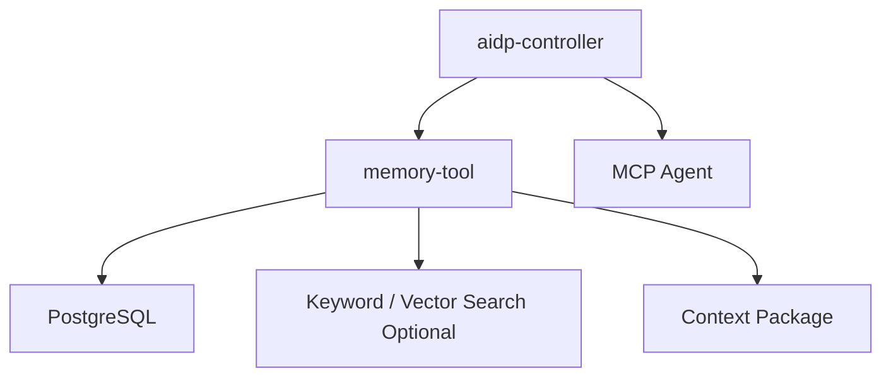

# memory-tool 架构设计

## 1. 架构定位

`memory-tool` 是上下文缓存和长期记忆服务，不替代文档知识库。`knowledge-tool` 负责大文档检索，`memory-tool` 负责小而关键、可直接放进 prompt 的记忆。



## 2. 核心流程

### 2.1 写入记忆

```text
validate scope
  -> normalize content
  -> assign status
  -> upsert by key or insert
  -> update search index optional
```

### 2.2 保存摘要

```text
receive session summary
  -> validate session scope
  -> version summary
  -> save latest active summary
```

### 2.3 生成上下文包

```text
load session summary
  -> search task related memories
  -> apply scope/status/expiry filters
  -> rank by relevance and importance
  -> fit max_tokens
  -> return package
```

## 3. 组件

| 组件 | 职责 |
|---|---|
| MemoryService | upsert、search、expire、review |
| SummaryService | 会话摘要保存和读取 |
| ContextPackageService | 组装上下文包 |
| TokenEstimateService | 估算 token 并裁剪 |
| MemoryRanker | 相关度、重要度、时间排序 |
| PermissionScopeService | workspace/project/session 隔离 |

## 4. 与其它工具关系

- `knowledge-tool` 返回文档片段，memory-tool 返回短记忆。
- `project-analyzer-tool` 可写入项目结构摘要。
- `quality-tool` 可写入反复出现的质量规则。
- controller 在每次任务开始前可调用 `memory.get_context`。

## 5. 降级策略

- 向量检索不可用时使用关键词检索。
- token 估算器不精确时使用保守字符估算。
- session summary 缺失时只返回长期记忆。

