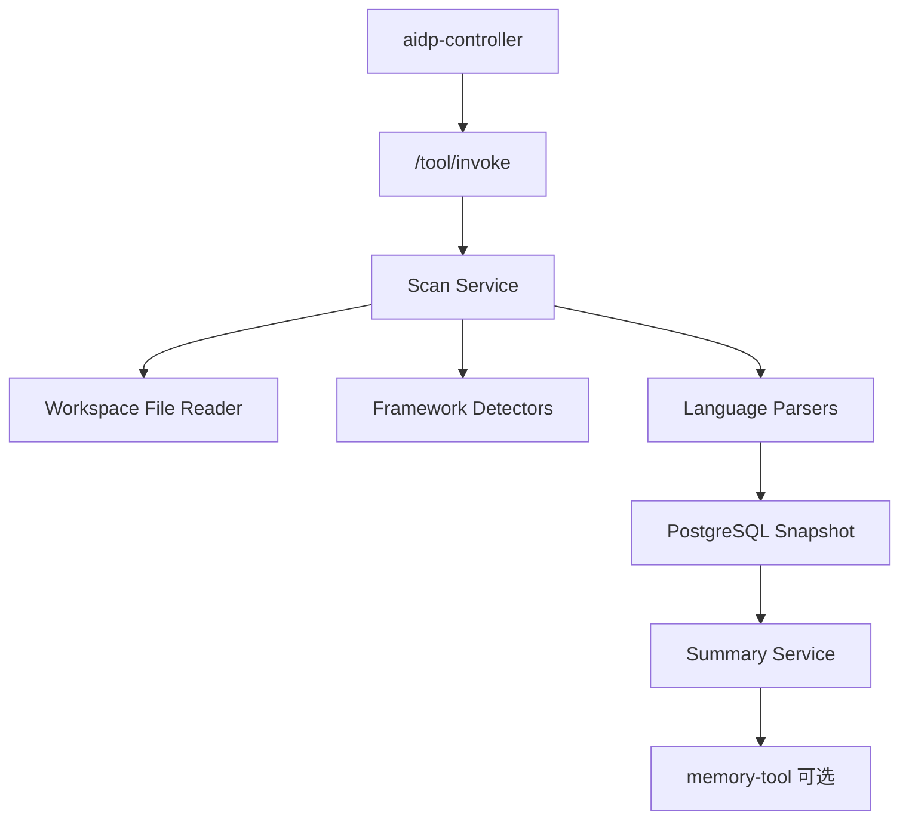

# project-analyzer-tool 架构设计

## 1. 架构



## 2. 扫描流程

```text
validate project path
  -> load ignore rules
  -> collect file tree
  -> detect languages/frameworks
  -> parse build files
  -> parse source symbols
  -> parse API routes
  -> parse database migrations
  -> save snapshot
  -> generate summary
```

## 3. 增量扫描

每个文件保存 `path/size/mtime/hash`。下一次扫描：

- 新增文件：解析。
- 修改文件：重新解析。
- 删除文件：标记 deleted。
- 未变化文件：复用旧解析结果。

## 4. 分析器插件

| 分析器 | 输入 | 输出 |
|---|---|---|
| `NodeAnalyzer` | `package.json/pnpm-lock.yaml` | workspace、scripts、dependencies |
| `PythonAnalyzer` | `pyproject.toml/requirements.txt` | package、dependencies、entrypoints |
| `FastifyAnalyzer` | TypeScript 源码 | route、service、repository、plugins |
| `DartAnalyzer` | Dart 源码 | class、function、widget、imports |
| `SqlMigrationAnalyzer` | SQL/XML/YAML | 表、字段、索引、迁移版本 |
| `ConfigAnalyzer` | yml/properties/env | 配置 key、profile |

## 5. 存储

- 结构化结果写 PostgreSQL。
- 大摘要可保存到对象存储。
- 不保存完整源码，只保存路径、hash、符号和摘要。

## 6. 安全边界

- 不执行项目脚本。
- 不下载依赖。
- 不读取 ignore 之外的大型二进制。
- 路径必须在允许 workspace 根目录内。
