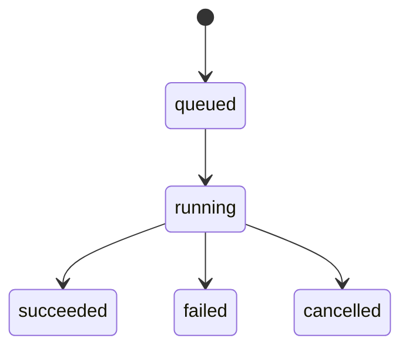

# project-analyzer-tool 模块设计

## 1. 模块

| 模块 | 职责 |
|---|---|
| `ProjectInvokeController` | capability 路由 |
| `ScanService` | 扫描编排 |
| `WorkspaceReader` | 安全读取文件树 |
| `IgnoreRuleService` | 默认和用户 ignore 合并 |
| `LanguageDetector` | 文件语言识别 |
| `FrameworkDetector` | Fastify/FastAPI/Flutter 等识别 |
| `AnalyzerRegistry` | 管理分析器插件 |
| `SymbolIndexService` | 保存和查询符号 |
| `DependencyGraphService` | 依赖图生成 |
| `SummaryService` | markdown/JSON 摘要 |
| `MemoryExportService` | 写入 memory-tool |

## 2. 扫描状态

## 3. 符号模型

符号字段：

- `symbol_type`：class、method、function、route、config_key、table。
- `name`
- `qualified_name`
- `file_path`
- `line_start`
- `line_end`
- `language`
- `module_name`
- `metadata`

## 4. 摘要生成策略

摘要不应罗列所有文件，而应围绕 AI 开发需要组织：

1. 项目是什么。
2. 用什么技术栈。
3. 如何启动、构建、测试。
4. 核心模块是什么。
5. API 入口在哪里。
6. 数据库结构在哪里。
7. 新增功能应优先修改哪些目录。
8. 需要注意哪些约束。

## 5. 异常处理

| 场景 | 处理 |
|---|---|
| 文件编码无法识别 | 标记 skipped，记录原因 |
| 单文件过大 | 跳过并记录 |
| 解析器失败 | 不终止全局扫描，记录 analyzer_error |
| 路径越界 | 返回 `FORBIDDEN` |
| 项目不存在 | 返回 `NOT_FOUND` |

## 6. 扩展点

- Tree-sitter 语法解析。
- Tree-sitter 深度 TypeScript/Python 分析。
- OpenAPI/Swagger 解析。
- Git diff 增量分析。
