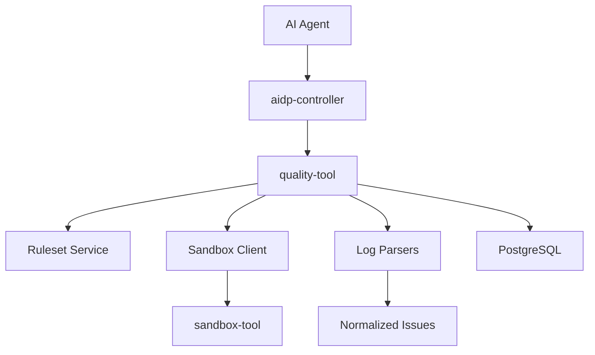
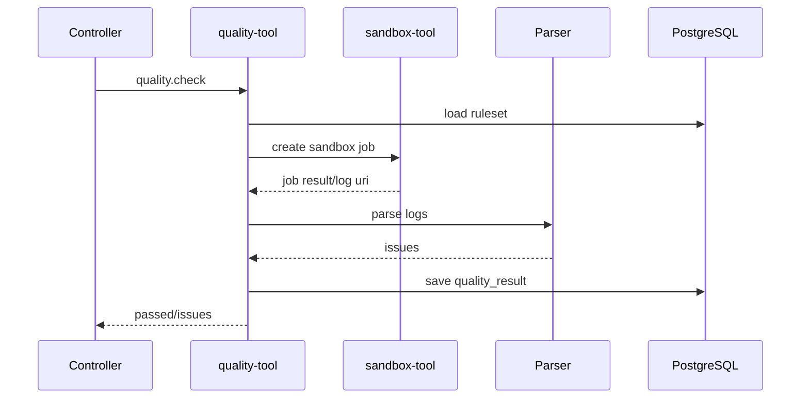

# quality-tool 架构设计

## 1. 架构定位

`quality-tool` 位于执行沙箱之后、AI 修复之前。它不负责执行不可信命令，而是编排 `sandbox-tool` 并解析输出。



## 2. 运行模式

### 2.1 standalone

可独立解析日志，也可配置 sandbox endpoint 后执行检查。

### 2.2 managed

由 controller 调用，controller 负责权限预检和审计，quality-tool 内部仍校验 workspace/project。

### 2.3 remote

团队可以把质量网关部署为远端服务，共享规则集。

## 3. 核心流程

### 3.1 完整质量检查



### 3.2 仅日志解析

```text
receive raw log or log_uri
  -> select parser
  -> parse diagnostics
  -> normalize issues
  -> optional save result
```

## 4. 核心组件

| 组件 | 职责 |
|---|---|
| QualityCheckService | 编排规则集、sandbox、解析器和结果保存 |
| RulesetService | 规则集管理、校验、解析 |
| SandboxClient | 调用 sandbox-tool capability |
| LogParserRegistry | 根据 parser 类型选择日志解析器 |
| TypeScriptLogParser | 解析 TypeScript、ESLint、Vitest 错误 |
| PythonLogParser | 解析 pytest、ruff、mypy 错误 |
| TestLogParser | 解析通用测试失败 |
| IssueNormalizer | 统一 issue 字段和 severity |
| QualityResultService | 保存和查询结果 |

## 5. 依赖策略

| 依赖 | MVP | 说明 |
|---|---|---|
| PostgreSQL | 必需 | 规则集和结果 |
| sandbox-tool | 可选 | 完整 check 需要；纯解析不需要 |
| Object Storage | 可选 | 保存大日志和报告 |

## 6. 降级策略

- sandbox 不可用时，`quality.check` 返回 `DEPENDENCY_UNAVAILABLE`。
- 解析器不支持时返回 `PARSER_NOT_FOUND`。
- 部分日志解析失败时保留 raw_log_uri，并返回 warning。

## 7. 与其它工具的关系

- 依赖 `sandbox-tool` 执行命令。
- 可把 issue 写入 `error-tool` 形成报错知识库。
- 可使用 `knowledge-tool` 检索修复规则。
- controller 将 `quality.check` 暴露为 MCP Skill。
