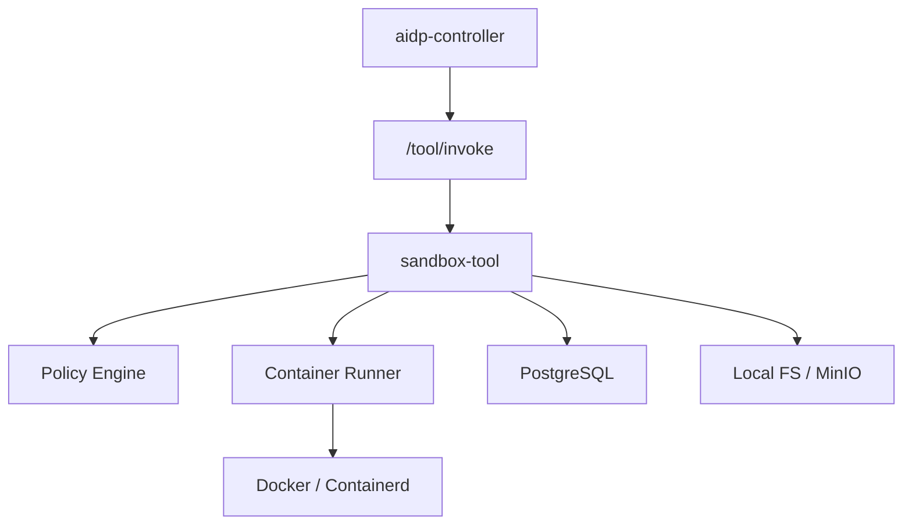
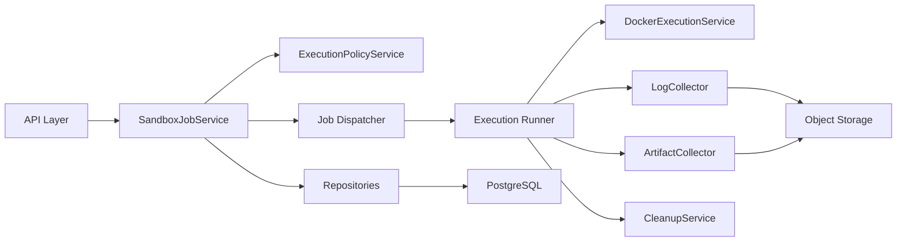
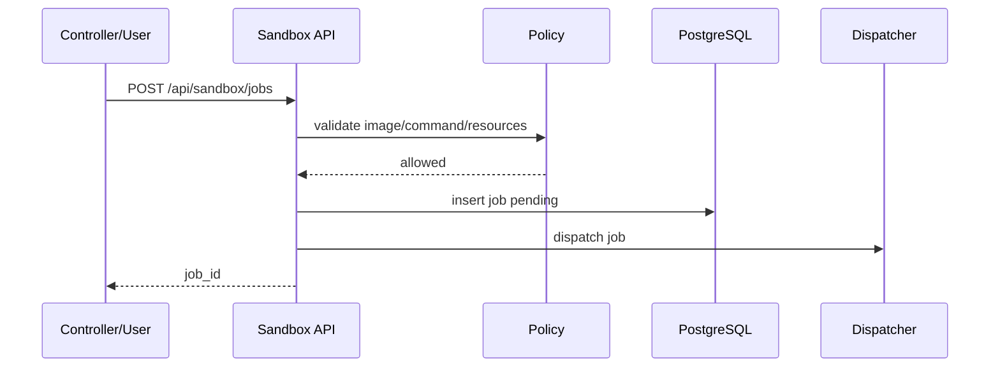
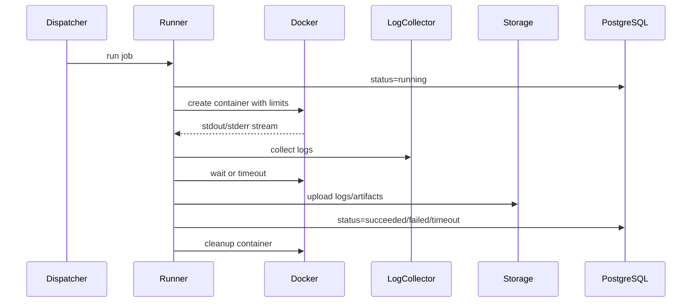

# sandbox-tool 架构设计

## 1. 架构定位

`sandbox-tool` 是独立安全执行服务。controller 只负责调用和审计，不直接执行命令。所有不可信任务必须进入 sandbox-tool，由它根据策略创建隔离容器。



## 2. 运行模式

### 2.1 standalone

用于个人或单工具部署：

```bash
aidp-sandbox serve --config config.yaml
```

必须显式配置 Docker/Containerd endpoint、镜像白名单和存储路径。

### 2.2 managed

由 controller 安装管理。controller 负责权限预检、trace、审计和 capability 注册。sandbox-tool 仍执行内部安全策略。

### 2.3 remote

沙箱部署在隔离机器，controller 只登记 endpoint。推荐团队和企业使用 remote 模式，把执行风险和 controller 隔离。

## 3. 内部架构



## 4. 核心组件

### 4.1 API Layer

- 工具协议接口。
- sandbox job 创建、查询、日志、产物接口。
- 参数校验。
- 统一错误响应。

### 4.2 SandboxJobService

- 创建任务。
- 校验 scope。
- 写入任务状态。
- 调度执行。
- 查询任务。

### 4.3 ExecutionPolicyService

- 镜像白名单。
- command 规则。
- network policy。
- resource limits。
- environment allowlist。
- artifact 限制。

### 4.4 Execution Runner

根据 job_type 选择执行器：

- ShellRunner。
- PythonRunner。
- NodeBuildRunner。
- PythonTestRunner。
- SqlValidateRunner。

### 4.5 DockerExecutionService

- 创建容器。
- 配置资源限制。
- 配置网络。
- 挂载工作目录。
- 执行命令。
- 捕获退出码。
- 超时 kill。

### 4.6 LogCollector

- 实时采集 stdout/stderr。
- 写入日志文件。
- 生成日志摘要。
- 控制最大日志大小。

### 4.7 ArtifactCollector

- 按规则收集 coverage、test-results、dist、reports 等产物。
- 过滤超大文件。
- 写入对象存储。
- 生成 artifact list。

### 4.8 CleanupService

- 删除容器。
- 删除临时目录。
- 清理过期日志和产物。
- 对账 lost running job。

## 5. 关键流程

### 5.1 创建任务



### 5.2 执行任务



### 5.3 SQL 验证

SQL 验证使用临时数据库容器：

```text
create db container
  -> execute init sql optional
  -> execute target sql
  -> capture result
  -> drop container and volume
```

禁止连接外部生产数据库。

## 6. 隔离策略

默认策略：

```text
network: none
privileged: false
readOnlyRootFilesystem: true
mounts: task workspace only
dockerSocket: forbidden
user: non-root if image supports
```

允许项目按 profile 放宽策略，例如 `build-with-network`，但必须显式配置且被 controller 审计。

## 7. 部署建议

### 7.1 本地个人

```text
sandbox-tool
postgres
docker
local storage
```

### 7.2 团队隔离

```text
controller
postgres
sandbox-tool on isolated host
docker/containerd
minio optional
```

## 8. 失败隔离

- 容器执行失败不影响 sandbox-tool 进程。
- 日志采集失败时仍记录 exit_code。
- artifact 采集失败时任务可标记 `artifact_failed` 或附加 warning。
- 清理失败必须记录并由后台重试。
