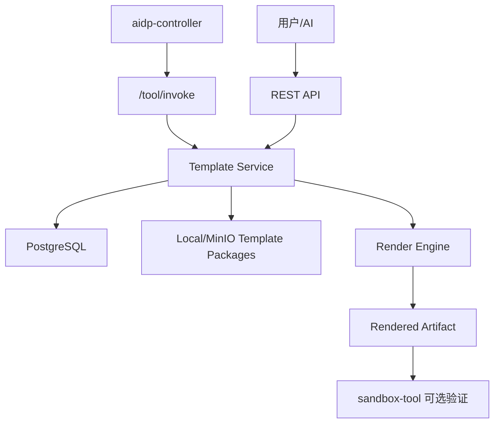

# template-tool 架构设计

## 1. 架构



## 2. 核心流程

### 2.1 注册模板

```text
receive zip/object_key
  -> size/path safety check
  -> unpack to temp
  -> read template.yaml
  -> validate variable schema
  -> compute checksum
  -> store package
  -> create template version
```

### 2.2 预览模板

```text
load template version
  -> validate variables
  -> render to temp workdir
  -> build file tree
  -> return limited text preview
  -> cleanup temp files
```

### 2.3 渲染模板

```text
load package
  -> validate variables
  -> render paths and text files
  -> copy binary files
  -> produce zip or write workspace
  -> save render job
```

## 3. 模板包格式

Zip 根目录必须包含：

```text
template.yaml
files/
```

示例：

```yaml
name: fastify-module
displayName: Fastify Module
type: module
version: 1.0.0
variables:
  - name: packageName
    type: string
    required: true
    regex: "^[a-z][a-z0-9_.]+$"
```

文件路径和内容都可使用 `{{packageName}}`。

## 4. 依赖

| 依赖 | 必选 | 用途 |
|---|---|---|
| PostgreSQL | 是 | 模板元数据、渲染任务 |
| 本地文件/MinIO | 是 | 模板包和产物 |
| sandbox-tool | 否 | 渲染后编译验证 |
| asset-tool | 否 | 模板关联资产检索 |

## 5. 安全边界

- 不执行模板包内脚本。
- 解压时拒绝绝对路径、`../`、符号链接。
- 渲染输出只能写入 job 专属目录。
- 二进制文件不做变量替换。
- secret 变量只可参与渲染，不进入日志和 preview。
