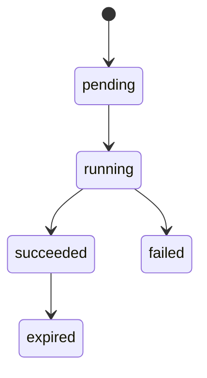

# template-tool 模块设计

## 1. 模块划分

| 模块 | 职责 |
|---|---|
| `TemplateInvokeController` | `/tool/invoke` capability 路由 |
| `TemplateController` | REST API |
| `TemplateRegistryService` | 模板创建、发布、版本管理 |
| `TemplateSearchService` | 模板检索和排序 |
| `TemplatePackageService` | Zip 包校验、解压、存储 |
| `VariableSchemaService` | 变量 schema 校验 |
| `RenderEngine` | 文件路径和内容渲染 |
| `PreviewService` | 文件树和文本预览 |
| `RenderJobService` | 渲染任务状态、产物管理 |
| `OutputSafetyService` | 防目录穿越、防覆盖 |

## 2. TemplatePackage 校验

必须检查 Zip 中有 `template.yaml`，所有路径是相对路径，不允许 `../`、绝对路径、符号链接，文件数和总大小不超过配置限制。

## 3. 变量校验

变量定义必须包含 `name`、`type`，可选 `required/default/regex/enum/min/max/secret/description`。required 且无默认值时必须传入；enum 变量必须命中枚举；regex 只作用于 string；secret 变量不得出现在响应 preview。

## 4. 渲染引擎

MVP 使用 Mustache 风格替换：`{{variableName}}`。

支持：

- 文本文件内容替换。
- 文件名替换。
- 目录名替换。
- 二进制文件原样复制。

文本文件通过扩展名白名单识别：`.ts`、`.tsx`、`.js`、`.jsx`、`.py`、`.dart`、`.yaml`、`.yml`、`.json`、`.xml`、`.md`、`.sql`、`.properties`、`.txt`。

## 5. RenderJob 状态

失败原因包括 `VARIABLE_VALIDATION_FAILED`、`PACKAGE_INVALID`、`OUTPUT_PATH_UNSAFE`、`RENDER_FAILED`、`STORAGE_FAILED`。

## 6. 输出策略

`output_mode` 支持：

- `artifact_zip`：生成 Zip，返回 URI。
- `workspace_dir`：写入指定工作目录。
- `preview_only`：只返回预览，不保存产物。

写入工作目录时默认禁止覆盖已有文件。`overwrite=true` 时必须返回 overwritten_files。

## 7. 扩展点

Cookiecutter、npm create、pnpm create、模板依赖另一个模板、渲染后自动调用 sandbox-tool。
